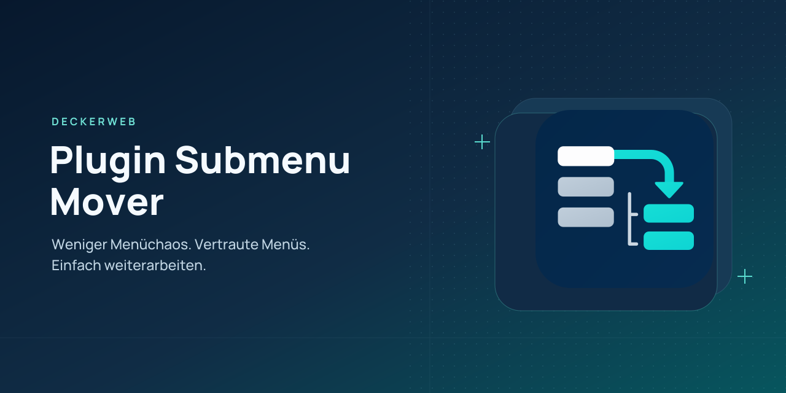

# Plugin Submenu Mover

[English](README.md)

## About

Plugin Submenu Mover entstand 2022 aus meinem eigenen WordPress-Alltag: Mit jedem zusätzlichen Plugin wurde das Adminmenü voller – und der Weg zur eigentlich gesuchten Einstellung länger. Ich wollte meine Werkzeuge schnell erreichen und wieder mehr Übersicht haben. Daraus wurde zunächst ein Code Snippet, 2025 schließlich ein eigenes Plugin.

Mit Version 2.0 wächst diese Idee zu einem flexiblen Arbeitsplatz für die tägliche Plugin-Verwaltung. Einzelne Plugin-Seiten lassen sich in passende Untermenüs einordnen. Umfangreichere Werkzeuge finden im optionalen Plugin-Hub zusammen: mit übersichtlichen Karten, schneller Suche und einem Kontext-Menü, das die ursprünglichen Plugin-Seiten erreichbar hält.

Persönliche Favoriten, kurze Bezeichnungen und dauerhaft eingehängte Plugin-Gruppen verkürzen wiederkehrende Wege. Arbeitsansichten helfen beim Wechsel zwischen verschiedenen Aufgaben. Und auf Kundenwebsites lässt sich festlegen, welche Benutzer den Hub verwenden – während andere ihren vertrauten Admin behalten.

Das Ziel ist seit 2022 dasselbe: weniger Zeit mit Suchen verbringen und leichter mit WordPress arbeiten.

**2.0.0** · WordPress **6.7+** · PHP **8.3+**

[FAQ](#faq) · [Änderungsverlauf](#changelog) · [GitHub](https://github.com/deckerweb/plugin-submenu-mover)

## Inhalt

- [Auf einen Blick](#at-a-glance)
- [Installation und erste Schritte](#installation)
- [Wichtige Funktionen](#features)
- [FAQ](#faq)
- [Änderungsverlauf](#changelog)
- [Hilfe und Sicherheit](#support)

## Auf einen Blick

- Weniger Menüchaos. Mehr Überblick. Plugin-Menüs sinnvoll einordnen und Platz für die tägliche Arbeit schaffen.
- Deine Plugins. Ein übersichtlicher Hub. Karten, Seitensuche und Kontext-Menü bringen umfangreiche Plugins zusammen.
- Deine Werkzeuge bleiben griffbereit. Eine ausgewählte Plugin-Gruppe bleibt auch auf anderen Adminseiten erreichbar.
- Deine wichtigsten Seiten. Dein direkter Weg. Persönliche Favoriten mit Kurzbezeichnungen im Hub, Adminmenü und in der Toolbar.
- Dein Workflow. Der vertraute Admin für Kunden. Einzelne Benutzer ausschließen, während andere den gesamten Hub nutzen.

## Installation und erste Schritte

1. Plugin-ZIP auf einer Test-Website installieren und aktivieren.
2. Werkzeuge → Plugin Submenu Mover öffnen oder Einstellungen in der Plugin-Liste wählen.
3. Automatische Verschiebungen prüfen. Ausnahmen oder Ziele anpassen, Änderungen vorab prüfen und anschließend übernehmen.
4. Für den Hub Plugin-Hub einschalten und bei den gewünschten Gruppen Im Hub verlinken oder Im Hub bündeln wählen. Änderungen prüfen und übernehmen.
5. Plugin-Hub öffnen. Karten, Seitensuche, Sterne und Plugin-Wechsler nutzen. Vorlagen für Arbeitsansichten auf der Einstellungsseite zusammenstellen.

## Wichtige Funktionen

### Vorhandene automatische Verschiebungen

Die übernommene Registry enthält 21 Integrationen. Verschiebungen einzelner Seiten erhalten ursprüngliche Berechtigungen und Hooks. Weitere funktionale Unterseiten, fehlende Ziele oder abweichende Registrierungen führen zum Überspringen. Der Hub erfasst registrierte Hauptmenüs außerhalb des WordPress-Kerns getrennt davon; die Erkennung bestätigt keine vollständige Plugin-Kompatibilität.

### Karten und Kontext-Menü

Auf der Hub-Übersicht listet das linke Menü alle ausgewählten Plugins alphabetisch. Die Auswahl öffnet die ursprüngliche Hauptseite des Plugins und zeigt dessen Seiten unter Plugin-Hub. Jede Karte bietet außerdem Plugin-Menü öffnen sowie drei direkte Seitenlinks; Alle Seiten klappt weitere auf. Beim Öffnen eines Plugins bleibt dessen Gruppe links und in der Toolbar eingehängt, bis eine andere gewählt oder Gruppe lösen benutzt wird. Sie bleibt auf fremden Adminseiten erreichbar; deren tatsächliches Menü bleibt korrekt aktiv. Alle Plugins öffnet die Übersicht, ohne die Gruppe zu lösen. Normale Adminlinks führen den Kontext pro Tab mit, sodass ein Wechsel in einem anderen Tab weder die aktuelle Seite noch deren Formulare verändert. Ein neuer Aufruf ohne Kontext verwendet die zuletzt persönlich eingehängte Gruppe. Alle Plugins führt zur Übersicht zurück, Plugin wechseln öffnet eine andere Gruppe. Seiten, Formulare und Callbacks bleiben in der Verantwortung von WordPress und dem jeweiligen Plugin. Karten zeigen sichere lokale Menüsymbole und Seitenzahlen. Die Suche findet Plugin- und Seitennamen einschließlich aufgeklappter Ziele; Enter öffnet die erste passende Seite, Escape setzt die Suche zurück. Favoriten werden bei verfügbarem JavaScript ohne Neuladen aktualisiert. Persönliche Ansicht fasst Arbeitsansicht und Verlaufseinstellungen in einem aufklappbaren Bereich zusammen. Die Toolbar zeigt die erlaubten Seiten der eingehängten Gruppe. Unter Werkzeuge → Plugin Submenu Mover lässt sich das websiteweite Symbol wählen; die Änderung wird vorab geprüft und übernommen. Fünf mitgelieferte textfreie Vektorsymbole und eine native Dashicons-Option stehen zur Auswahl.

### Gruppen dieser Installation auswählen

Die Einstellungen zeigen aktuell erlaubte Plugin-Menügruppen statt aller installierten Plugins. Suche und Filter grenzen alle, ausgewählte, nicht ausgewählte oder zu prüfende Gruppen ein. Zeilen einzeln oder alle sichtbaren Zeilen markieren und anschließend verlinken, bündeln, ausschließen oder nur die markierten Gruppen verwenden. Markierungen bleiben beim Filtern erhalten; Aktionen berücksichtigen auch ausgeblendete markierte Zeilen. Erst Vorschau und Übernehmen ändern die Konfiguration. Neu erkannte Gruppen bleiben ungewählt. Installation neu einlesen aktualisiert die Übersicht ohne automatische Auswahl. Bereits gespeicherte Entscheidungen für derzeit nicht verfügbare Gruppen bleiben ruhend erhalten. Aufgabenvorlagen für Wartung, Inhalte und Website-Aufbau schlagen Treffer anhand lokaler Menünamen und Plugin-Identitäten vor; sie bestätigen keine Kompatibilität. Eine Vorlage markiert zunächst nur passende Gruppen. Gespeicherte Arbeitsansichten können ebenfalls aktuell vorhandene passende Gruppen markieren. Exportierte Hub-Einstellungen und Arbeitsansichten lassen sich über den bestehenden Prüfablauf auf anderen Websites importieren; fehlende Gruppen bleiben ruhend, importierte Bündelungen werden bis zur lokalen Bestätigung als Links übernommen.

### Den Hub am Arbeitsplatz platzieren

Administratoren wählen in den Hub-Einstellungen die websiteweite Position im Adminmenü und in der Toolbar, prüfen die Vorschau und übernehmen. Im Adminmenü ist eine Position vor oder nach einem vorhandenen Menüpunkt möglich. Die Toolbar bietet die Standardposition, den Anfang der linken Seite, eine Position nach einem anderen linken Eintrag oder rechts vor dem Benutzerkonto. Andere Einträge behalten ihre relative Reihenfolge und ursprünglichen Unterpunkte. Fehlende oder nicht verfügbare Bezugspunkte führen zur Standardposition zurück. Die Verfügbarkeit kann je nach Berechtigung abweichen; die Originalansicht stellt vorübergehend die gewöhnliche Navigation her. Export/Import und Rückgängig berücksichtigen Positionen; ältere Importe lassen die aktuelle Platzierung bestehen.

### Verlinken oder bündeln

Beim Verlinken bleibt das ursprüngliche Menü sichtbar. Beim Bündeln verschwindet der Haupteintrag, solange die lokal bestätigte Struktur unverändert ist; Seitenregistrierung und ursprüngliche Untermenüs bleiben erhalten. Ändern sich registrierte Ziele oder Berechtigungen, kehrt der Haupteintrag bis zur erneuten Prüfung zurück. Das Bündeln mit den tatsächlich verwendeten Plugins und Versionen auf Staging testen, insbesondere zusammen mit einem weiteren Menüeditor.

### Vorschau, Import und Rückgängig

Gemeinsame Änderungen werden für eine Stunde vorgemerkt und erst beim Übernehmen wirksam. Die Vorschau zeigt vorherige und neue Werte; geänderte Verschieberegeln lassen sich einzeln auswählen. Zwischenzeitliche gemeinsame Änderungen verhindern ein veraltetes Übernehmen oder Rückgängigmachen. Der Import führt passende Kennungen zusammen und erhält übrige sowie derzeit nicht verfügbare Regeln. Importierte Bündelungen werden bis zur lokalen Prüfung als Links übernommen. Der Export enthält gemeinsame Hub-Auswahl und Arbeitsansichten, niemals Favoriten, Verlauf, Zugangsdaten oder Löschzustimmung. Schema-1-Importe bleiben möglich.

### Persönliche Schnellzugriffe und Arbeitsansichten

Sterne heften einzelne registrierte Seiten an, ohne das ganze Plugin zu verschieben. Favoriten gehören zum Benutzer und zur Website und erscheinen auch in der nativen Toolbar. Der Verlauf ist anfangs ausgeschaltet; nach Zustimmung werden bis zu zwölf registrierte Kennungen lokal gespeichert. Er lässt sich löschen. Arbeitsansichten filtern gewählte Plugin-Gruppen etwa für Einrichtung, Inhalte oder Wartung. Sie ändern keine Berechtigungen. Favoriten erscheinen auch unter Alle Plugins im linken Hub-Menü. Die Hub-Übersicht enthält einen eigenen Favoritenbereich mit Erklärung, solange er leer ist. Beim Anheften wird das linke Menü sofort aktualisiert; die Toolbar folgt beim nächsten Seitenaufruf. Unter Persönliche Navigation auf dieser Website lassen sich Favoriten mit tastaturbedienbaren Tasten sortieren und optional kurz benennen; die ursprünglichen Namen bleiben in der Verwaltung und als ergänzende Information erhalten. Gruppe, Favoriten und Arbeitsansicht lassen sich getrennt zurücksetzen, ohne gemeinsame Regeln zu ändern.

### Native Befehlspalette und Website-Zustand

Wo WordPress seine native Befehlspalette bereitstellt, findet Plugin-Hub Favoriten, erlaubte Plugin-Seiten, Gruppen, Arbeitsansichten, persönliche Navigation, Einstellungen, Website-Zustand und die zeitweise Originalansicht. Deutsche und englische Suchbegriffe ergänzen typische Aufgaben. WordPress 6.7 bietet die Palette in unterstützten Editoren; ihre Verfügbarkeit an anderen Stellen hängt vom Kern ab. Das Plugin baut keine zweite Palette. Website-Zustand ergänzt eine lesende Prüfung der gespeicherten Konfiguration und sparsame Supportangaben: Versionen, Schaltzustand, Anzahlen und Schema. Persönliche Favoriten, Beschriftungen, Verlauf und Seiten-URLs werden dort nicht ausgegeben; optionale Funktionen dürfen ausgeschaltet bleiben. Nach lokaler Strukturbestätigung werden spätere Änderungen als Anzahl neuer/entfernter Seiten und geänderter Berechtigungen sichtbar. Vorhandene Beta5-Bestätigungen erhalten beim nächsten Prüfen und Übernehmen einen detaillierten Strukturstand.

### Originalansicht und Diagnose

Originalmenü für eine Stunde anzeigen stellt die ursprüngliche Navigation vorübergehend für das eigene Administratorkonto auf dieser Website wieder her. Gespeicherte Regeln und persönliche Einstellungen bleiben erhalten. Die Diagnose beschreibt Versionen und Ergebnisse; eigene Beschriftungen vor dem Weitergeben prüfen. WP-CLI wp psm rules exportiert die Konfiguration, ohne eine Prüfung des aktuellen Adminmenüs vorzutäuschen.

### Voraussetzungen und gemeinsame Komponenten

WordPress 6.7+ und PHP 8.3+ bleiben die Mindestanforderungen. Enthalten sind deckerweb Library 1.0.0 und Updater 2.1.0; ein zusätzliches Komponenten-Plugin ist nicht erforderlich. Der optionale Onlinekatalog der Library ist zunächst ausgeschaltet. Der Updater ruft stabile Release-Metadaten und gewählte Updatepakete von GitHub ab. Keine Telemetrie. Die Auslieferung erfolgt ausschließlich als installierbares Plugin-ZIP.

### Gruppenleiste und Kurzbezeichnungen

Die Gruppenleiste lässt sich unter Persönliche Navigation auf dieser Website oder auf der Einstellungsseite des Plugins ein- und ausblenden. Diese persönliche Einstellung gilt nur für das aktuelle Konto und die Website; die eingehängte Gruppe bleibt im Adminmenü und in der Toolbar erhalten. Eine Favoriten-Kurzbezeichnung bildet das gesamte sichtbare Menülabel. Ursprüngliche Namen bleiben in der Favoritenverwaltung und als ergänzende Linkinformation verfügbar. Die Plugin-Auswahl zeigt noch nicht übernommene Änderungen an und erklärt Vorlagentreffer. Konfigurationsimporte akzeptieren bis zu 1 MiB und decken damit die begrenzten gemeinsamen Exporte des Plugins ab.

### Einzelne Benutzer ausschließen

Unter Werkzeuge → Plugin Submenu Mover → Plugin-Hub → Ausgeschlossene Benutzer nach Namen oder Benutzernamen suchen und mehrere Konten auswählen. Ausgewählte Benutzer bleiben bei weiteren Suchen und beim Nachladen sichtbar und können einzeln entfernt werden. Änderungen vorab prüfen und übernehmen. Das eigene Konto ist nicht auswählbar. Ohne JavaScript bleibt die Eingabe von Benutzer-IDs als Rückfall verfügbar. Ausnahmen gelten nur für diese Website und werden weder exportiert noch importiert. Ausgeschlossene Benutzer behalten ursprüngliche Menüs, Rollen und persönliche Einstellungen. Dies ist eine Arbeitsplatz-Einstellung und kein Schutz vor einem Administrator, der Plugins deaktivieren oder Code ändern kann.

## FAQ

### Ändert ein aufgeräumtes Menü die Zugriffsrechte?

Nein. Jedes Ziel behält seine ursprüngliche Berechtigung. Arbeitsansichten und Menüsichtbarkeit dienen der Navigation und sind keine Zugriffskontrolle.

### Warum fehlt ein Plugin oder bleibt unverändert?

Der Hub zeigt registrierte, erlaubte Hauptmenüs außerhalb des WordPress-Kerns; Core-Menüs und Inhaltstyp-Hauptmenüs sind ausgenommen. Eine Seite kann für das eigene Konto fehlen, extern verlinkt oder nicht registriert sein. Automatische Verschiebungen verwenden die kuratierte Registry. Regeln nicht verfügbarer Integrationen bleiben gespeichert.

### Kann ich zehn Plugins bündeln?

Der Hub unterstützt mehrere ausgewählte Gruppen, auch zehn oder mehr. Karten und Kontext-Menü verwenden dieselben registrierten Ziele. Die Gruppenanzahl garantiert keine Kompatibilität mit beliebigen Drittplugin-Versionen.

### Was passiert nach einem Update des Zielplugins?

Eine geänderte registrierte Menüstruktur verhindert das Ausblenden der ursprünglichen Gruppe bis zur erneuten Prüfung. Version und Identität erscheinen, wenn das installierte Plugin anhand seines registrierten Callbacks zugeordnet werden kann. Menüerkennung bestätigt keinen vollständigen Funktionstest.

### Funktioniert das mit einem weiteren Menüeditor?

Pro Gruppe sollte ein Werkzeug zuständig sein. Weitere Editoren können Registrierung oder Auswahlmarkierung verändern. Bei der Fehlersuche Verlinkung oder Originalansicht verwenden; eine pauschale Kompatibilitätszusage gibt es nicht.

### Was gilt für Multisite?

Regeln, Hub-Auswahl und Arbeitsansichten gehören zur einzelnen Website; Favoriten und Verlauf zum Benutzer und zur Website. Netzwerk-Admin-Menüs bleiben unverändert. Bei Netzwerkaktivierung gelten die jeweiligen Website-Einstellungen; neue Websites beginnen mit Standardwerten.

### Welche Daten bleiben nach Deaktivierung oder Deinstallation?

Deaktivierung erhält die Konfiguration. Deinstallation entfernt temporäre Vorschau-, Rückgängig- und Originalansicht-Daten. Website-Einstellungen und persönliche Schnellzugriffe bleiben standardmäßig erhalten; die ausdrückliche Löschoption entfernt eigene Daten dieser Website. Bei Netzwerkdeinstallation gilt die Auswahl jeder Website. Die gemeinsame Library bereinigt Daten nach ihrer Letzt-Host-Regel. Andere Plugins und deren Inhalte bleiben erhalten.

[Fragen nach Themen](docs/FAQ-de.md)

## Änderungsverlauf

### 2.0.0 · 2026-10-19
- Neu: Optionaler Plugin-Hub mit Karten, Suche und dauerhaft eingehängter Plugin-Gruppe.
- Neu: Persönliche Favoriten und Kurzbezeichnungen, Befehlspalette und Site Health.
- Neu: Positionswahl, Auswahlvorlagen und durchsuchbare Benutzer-Ausnahmen.
- Verbessert: Navigation, Einstellungen und Vektorgrafiken.
- Behoben: Erkennung von ACF und JetFormBuilder.
- Sonstiges: Erfordert PHP 8.3 oder neuer; WordPress weiterhin 6.7 oder neuer.

### 1.4.0 · 2025-03-28
- Neu: Erste öffentliche Version mit klassenbasierter Architektur.
- Sonstiges: Grundlage ist die seit 2022 privat verwendete Version.

### 1.0.0 · 2022-07
- Neu: Erste private Version.

## Autor und Zweck

Entwickelt von David Decker – DECKERWEB. 2022 als Code Snippet für einen persönlichen Bedarf entstanden, 2025 als Plugin veröffentlicht. Version 2.0 ergänzt einen flexiblen Arbeitsplatz für die tägliche Plugin-Verwaltung.

## Hilfe und Sicherheit

[Issues](https://github.com/deckerweb/plugin-submenu-mover/issues) · [Private security report](https://github.com/deckerweb/plugin-submenu-mover/security/advisories/new) · [Ko-fi](https://ko-fi.com/deckerweb) · [PayPal](https://paypal.me/deckerweb)

Sicherheitslücken vertraulich über den Sicherheitsmeldeweg des Repositorys melden. Keine Zugangsdaten oder Exploit-Details in öffentlichen Issues veröffentlichen. Ist die private Meldefunktion nicht verfügbar, vertrauliche Kontaktmöglichkeiten von GitHub nutzen und keine sensiblen Details veröffentlichen.

## Lizenz und Herkunft

Copyright © 2022–2026 David Decker – DECKERWEB. GPL v2 or later. SPDX: GPL-2.0-or-later.

Enthaltene deckerweb Library und Updater: David Decker – DECKERWEB, GPL-2.0-or-later. Freigegebenes Pfeilmotiv erhalten. Bannerschrift: Manrope (SIL OFL 1.1), siehe assets/OFL-Manrope.txt. Grafiken werden lokal ausgeliefert.
