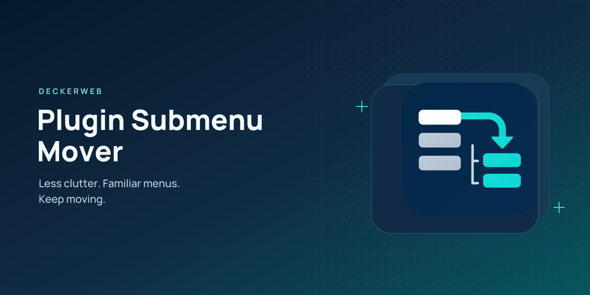

# Plugin Submenu Mover

[Deutsch](de.html)

[Download 2.0.0](https://github.com/deckerweb/plugin-submenu-mover/releases/download/v2.0.0/plugin-submenu-mover-2.0.0.zip) · [Wiki](https://github.com/deckerweb/plugin-submenu-mover/wiki)

## About

Plugin Submenu Mover started in 2022 with a frustration from my own WordPress work: every additional plugin made the admin menu busier and the setting I needed harder to find. I wanted quicker access to my tools and a clearer workspace. The first solution was a code snippet. In 2025, it became a plugin.

Version 2.0 expands that idea into a flexible workspace for everyday plugin management. Individual plugin pages can move into suitable submenus. Larger tools can come together in the optional Plugin Hub, with clear cards, quick search and a contextual menu that keeps their original pages within reach.

Personal favorites, short labels and persistent plugin groups make recurring tasks easier to access. Workspaces help organize different kinds of work. On client sites, individual users can keep their familiar admin while others use the full hub.

The goal has stayed the same since 2022: spend less time looking for things and make working with WordPress easier.

**2.0.0** · WordPress **6.7+** · PHP **8.3+**

[FAQ](#faq) · [Changelog](#changelog) · [GitHub](https://github.com/deckerweb/plugin-submenu-mover)

## Contents

- [At a Glance](#at-a-glance)
- [Installation and first steps](#installation)
- [Main features](#features)
- [FAQ](#faq)
- [Changelog](#changelog)
- [Support and security](#support)

## At a Glance

- Less menu clutter. More clarity. Organize plugin menus and make room for everyday work.
- Your plugins. One clear hub. Cards, page search and contextual navigation bring multi-page tools together.
- Your tools stay within reach. An attached plugin group remains available across other admin pages.
- Your key pages. Your direct route. Personal favorites with short labels in the hub, admin menu and toolbar.
- Your workflow. A familiar admin for clients. Exclude individual users while others use the full hub.

## Installation and first steps

1. Install the plugin ZIP on a test site and activate it.
2. Open Tools → Plugin Submenu Mover, or Settings in the plugin list.
3. Review automatic moves. Change exceptions or targets, choose Preview changes, then Apply changes.
4. For the hub, enable Plugin Hub and choose Link from hub or Bundle in hub for the desired groups. Review and apply.
5. Open Plugin Hub. Use the cards, Find a page, stars and plugin switcher. Configure workspace templates on the settings page.

## Main features

### Existing automatic moves

The inherited registry contains 21 integrations. Single-page moves keep the original capabilities and hooks. Extra functional subpages, absent destinations or conflicting registrations cause a move to be skipped. The hub discovers registered non-core top-level menus separately; discovery is not a full compatibility certification.

### Cards and contextual navigation

On the hub overview, the left menu lists all selected plugins alphabetically. Choose one to open its original main page and display its pages below Plugin Hub. Each card also provides Open plugin menu and three direct page links; All pages expands the rest. Opening a plugin attaches its group to the sidebar and toolbar until another group is selected or Detach group is used. It remains available on unrelated admin pages; their real current menu stays active. All plugins opens the overview without detaching. Ordinary admin links carry a tab-local context, so switching in another tab does not change the current page or its forms. A fresh untagged visit uses the last personal group. Use All plugins to return to the overview, or Switch plugin to open another group. WordPress and the target plugin continue to own their pages, forms and callbacks. Cards show safe local menu icons and page counts. Search matches plugin and page names, including expanded destinations; Enter opens the first matching page and Escape clears the query. Favorites update without reloading when JavaScript is available. Personal view groups workspace and history preferences in a collapsible section. The toolbar shows the attached plugin’s allowed pages. Choose its site-wide icon under Tools → Plugin Submenu Mover; preview and apply the change. Five bundled text-free vector icons and a native Dashicons option are available.

### Choose groups from this installation

The settings inventory lists currently permitted plugin menu groups rather than every installed plugin. Search and filter all, selected, unselected or review-required groups. Mark rows individually or mark visible rows, then link, bundle, exclude or use only the marked groups. Marked rows remain marked across filters; actions include hidden marked rows. Nothing changes until Preview and Apply. Newly discovered groups stay unselected. Read installation again refreshes the inventory without automatically selecting plugins. Existing choices for currently unavailable groups remain dormant. Task templates for Maintenance, Content and Site building suggest matches in the local menu names and plugin identities; they do not certify compatibility. A template only marks matches first. Saved workspaces can also mark current matching groups. Exported hub settings and workspaces can be imported on another site through the existing review flow; missing groups remain dormant and imported bundles become links until locally approved.

### Place the hub in your workplace

Administrators choose the site-wide admin menu and toolbar position in hub settings, then preview and apply. The admin menu supports positions before or after a current menu entry. The toolbar supports its default position, the beginning of the left side, after another current left-side entry, or on the right before the user account. Other entries retain their relative order and original children. Missing or unavailable anchors use the default position. Availability can differ by user permissions; the original-view switch temporarily restores the ordinary navigation. Export/import and Undo include positions; older imports leave current placement unchanged.

### Link or bundle

Link mode retains the original menu. Bundle mode hides the original top-level entry while the locally accepted structure remains unchanged; it preserves original registrations and child arrays. If the registered destinations or capabilities change, the original entry returns until the structure is reviewed again. Test bundling with the actual plugins and versions on staging, especially with another menu editor.

### Preview, import and undo

Shared changes are staged for one hour and do not take effect until applied. The review shows before/after values; changed mover rules can be selected individually. A concurrent shared change blocks an outdated apply or undo. Import merges matching IDs and retains unrelated and unavailable rules. Imported bundle selections become links until locally reviewed. Export includes shared hub selections and workspaces, never favorites, history, credentials or deletion consent. Schema 1 imports remain supported.

### Personal shortcuts and workspaces

Stars pin individual registered pages without moving the complete plugin. Favorites are scoped to your user and site and appear in the native toolbar. Recent-page history is off initially; opt in to retain up to 12 registered IDs locally, or clear it. Workspaces filter chosen plugin groups for tasks such as setup, content or maintenance. They do not change permissions. Favorites also appear below All plugins in the hub sidebar. The hub overview keeps a dedicated Favorites section, with an explanation while empty. Sidebar favorites update immediately when pinning; toolbar entries refresh on the next page navigation. Under Your navigation on this site, reorder favorites with keyboard-accessible buttons and assign optional short labels; original names remain in management and supplementary information. Group, favorites and workspace view can each be reset separately without changing shared rules.

### Native command palette and Site Health

Where WordPress provides its native command palette, search for Plugin Hub to open favorites, permitted plugin pages, groups, workspaces, personal controls, settings, Site Health or the temporary original menu. English/German search synonyms cover common tasks. WordPress 6.7 provides the palette in supported editors; its availability elsewhere depends on core. This plugin does not create a second palette. Site Health adds a read-only stored-configuration check and minimal support information: versions, enabled state, counts and schema. It does not report personal favorites, labels, history or page URLs; optional features may remain disabled. After accepting a structure locally, later changes show counts for added/removed pages and changed permissions. Existing beta5 approvals acquire a detailed snapshot on the next preview and apply.

### Original view and diagnostics

Show original menu for one hour temporarily restores the original navigation for your administrator account on this site. Saved rules and preferences remain. Diagnostics describe versions and move outcomes; review custom labels before sharing the report. WP-CLI wp psm rules exports configuration without pretending to inspect a live admin menu.

### Requirements and shared components

WordPress 6.7+ is retained; version 2.0 requires PHP 8.3+. This package embeds deckerweb Library 1.0.0 and Updater 2.1.0; no separate component plugin is required. Optional Library online catalog retrieval defaults off. The updater contacts GitHub for stable release metadata and selected update packages. No telemetry is included. Distributed exclusively as an installable plugin ZIP.

### Group bar and short labels

Show or hide the group bar under Your navigation on this site or on the plugin settings page. This personal preference affects only the current account and site; the attached group remains in the admin menu and toolbar. A favorite short label is the complete visible menu label; original names remain in favorite management and supplementary link information. The selection screen indicates unsaved configuration changes and explains template matches before anything is applied. Configuration imports accept up to 1 MiB, covering the plugin’s bounded shared exports.

### Exclude individual users

Under Tools → Plugin Submenu Mover → Plugin Hub → Excluded users, search by name or username and select several accounts. Selected users remain visible while searching or loading more results, and can be removed individually. Preview and apply. Your own account cannot be selected. User IDs remain as a fallback when JavaScript is unavailable. Exclusions apply only to this site and are not exported or imported. Excluded users retain their original menus, roles and personal preferences. This is a workplace preference, not protection against an administrator who can deactivate plugins or edit code.

## FAQ

### Does a cleaner menu change access permissions?

No. Each destination retains its original capability. Workspaces and menu visibility are navigation preferences, not access control.

### Why is a plugin missing or unchanged?

The hub lists registered, permitted non-core top-level menus; core menus and post-type roots are excluded. A page may be unavailable to your account, externally linked or not registered. Existing automatic moves use their curated registry. Rules for unavailable integrations remain stored.

### Can I bundle ten plugins?

The hub supports multiple selected groups, including ten or more. Cards and the context menu use the same registered destinations. The number of groups is not a guarantee of compatibility with arbitrary third-party versions.

### What happens after a target plugin update?

A changed registered menu structure prevents hiding that original group until reviewed again. Version and identity are shown when the callback’s owning installed plugin can be identified. Menu discovery does not prove every plugin function was tested.

### Does it work with another menu editor?

Let one tool own each group. Another editor can change registrations or visual selection. Use link mode or original view while diagnosing conflicts; universal compatibility is not promised.

### What about Multisite?

Rules, hub selections and workspaces belong to each site; favorites and history belong to each user and site. Network Admin menus are untouched. Network activation uses each site’s own settings; newly created sites start with defaults.

### What data remains after deactivation or uninstall?

Deactivation preserves configuration. Uninstall removes temporary preview, undo and original-view metadata. Site settings and personal shortcuts remain by default; the explicit deletion switch removes this plugin’s data for the site. On network uninstall each site’s choice is respected. Shared Library cleanup follows its last-host policy. Other plugins and their content remain untouched.

[FAQ by topic](https://github.com/deckerweb/plugin-submenu-mover/wiki/FAQ-by-topic)

## Changelog

### 2.0.0 · 2026-10-19
- New: Optional Plugin Hub with cards, search and a persistent attached plugin group.
- New: Personal favorites and short labels, command palette and Site Health integration.
- New: Position settings, selection templates and searchable user exclusions.
- Improved: Navigation, settings and vector artwork.
- Fixed: Detection of ACF and JetFormBuilder.
- Misc: Requires PHP 8.3 or newer; WordPress 6.7 or newer is retained.

### 1.4.0 · 2025-03-28
- New: Initial public release with class-based architecture.
- Misc: Based on the privately used version since 2022.

### 1.0.0 · 2022-07
- New: Initial private release.

## Author and scope

Developed by David Decker – DECKERWEB. Started in 2022 as a code snippet for a personal need; released as a plugin in 2025. Version 2.0 adds a flexible workspace for everyday plugin management.

## Support and security

[Issues](https://github.com/deckerweb/plugin-submenu-mover/issues) · [Private security report](https://github.com/deckerweb/plugin-submenu-mover/security/advisories/new) · [Ko-fi](https://ko-fi.com/deckerweb) · [PayPal](https://paypal.me/deckerweb)

Report security vulnerabilities privately through the repository’s Security reporting channel. Do not post credentials or exploit details in public issues. If the private report option is unavailable, use GitHub’s private contact options; do not publish sensitive details.

## License and origin

Copyright © 2022–2026 David Decker – DECKERWEB. GPL v2 or later. SPDX: GPL-2.0-or-later.

Bundled deckerweb Library and Updater: David Decker – DECKERWEB, GPL-2.0-or-later. Approved arrow motif retained. Banner text uses Manrope (SIL OFL 1.1); see assets/OFL-Manrope.txt. Graphics are local.
